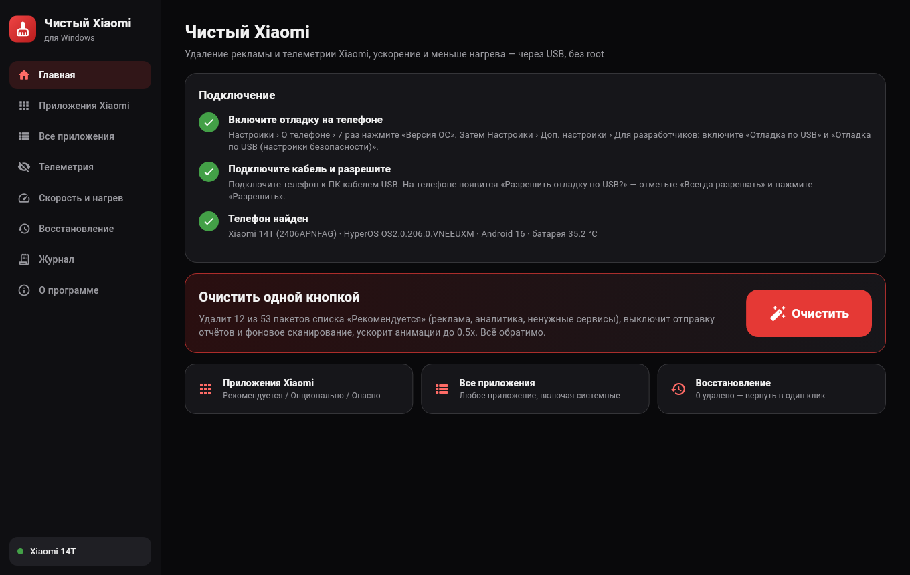

# Чистый Xiaomi для Windows

Программа для ПК, которая через USB убирает с телефона Xiaomi / Redmi / POCO (HyperOS, MIUI) рекламу,
телеметрию и ненужные приложения, ускоряет интерфейс и помогает снизить нагрев. **Root не нужен**, загрузчик не разблокируется.

Автор: **Урдуханов Марат Закирович** · [sessia.top](https://sessia.top)

Скачать: **https://sessia.top/files/ChistyXiaomi-Setup-1.0.0.exe** (Windows 10/11 x64, установка без прав администратора)



## Возможности

- **Очистить одной кнопкой** — удаляет пакеты из списка «Рекомендуется» (реклама, аналитика, лишние сервисы), выключает отправку отчётов и фоновое сканирование, анимации 0.5x.
- **Приложения Xiaomi** — проверенные списки: Рекомендуется / Опционально / Опасно.
- **Все приложения** — любое установленное приложение, включая системные: поиск, фильтры (системные / пользовательские / Xiaomi / Google), выбор галочками.
  - критичные пакеты (рабочий стол, SystemUI, настройки, телефон, Security, провайдеры, MediaTek и т. п.) — только после галочки и ввода слова «УДАЛИТЬ»;
  - прочие опасные/системные — с предупреждением.
- **Телеметрия**, **Скорость и нагрев** (оптимизация приложений `compile speed-profile`, `bg-dexopt`, температуры датчиков), **Восстановление**, **Журнал**.
- Каждая команда ограничена по времени, зависшие пропускаются, есть кнопка «Отмена». Список удалённого сохраняется на ПК (`%APPDATA%\ChistyXiaomi`).

Удаление выполняется командой `pm uninstall -k --user 0`: приложение остаётся в прошивке и возвращается на вкладке «Восстановление» (`cmd package install-existing`).

## Как пользоваться

1. На телефоне: Настройки › О телефоне › 7 раз нажмите «Версия ОС».
2. Настройки › Доп. настройки › Для разработчиков: включите **«Отладка по USB»** и **«Отладка по USB (настройки безопасности)»** (нужен Mi-аккаунт и SIM).
3. Запустите «Чистый Xiaomi» и подключите телефон кабелем; на телефоне нажмите «Разрешить» (отметьте «Всегда»).
4. Когда телефон определится — нажмите «Очистить» или выберите приложения вручную.

Если телефон не появляется: режим USB «Передача файлов», другой кабель/порт, в Диспетчере устройств — драйвер ADB
(Windows Update › Дополнительные обновления, или [Google USB Driver](https://developer.android.com/studio/run/win-usb)).

## Ограничения

- Без root приложения удаляются только для пользователя; после сброса к заводским настройкам и некоторых обновлений они вернутся.
- Установщик не подписан сертификатом — Windows SmartScreen покажет предупреждение («Подробнее › Выполнить в любом случае»).
- Названия неизвестных приложений выводятся из имени пакета.

## Сборка

Сборка — GitHub Actions (`.github/workflows/windows-pc.yml`, `windows-latest`): Flutter 3.47.7 → `flutter build windows`,
`adb` из официального архива Google Platform-Tools (версия и SHA-256 закреплены), установщик Inno Setup 7.1, затем тихая установка и проверка запуска.

```
cd pc
flutter test test/logic_test.dart
flutter build windows --release
```

## Лицензия

Код программы — GPL-3.0 (`LICENSE`). Сторонние компоненты, в том числе `adb` (Android SDK Platform-Tools, © Google, свои условия) — см. `THIRD_PARTY_NOTICES.md`.
